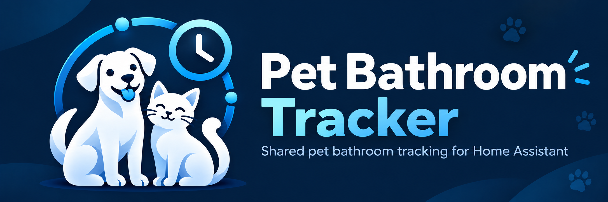
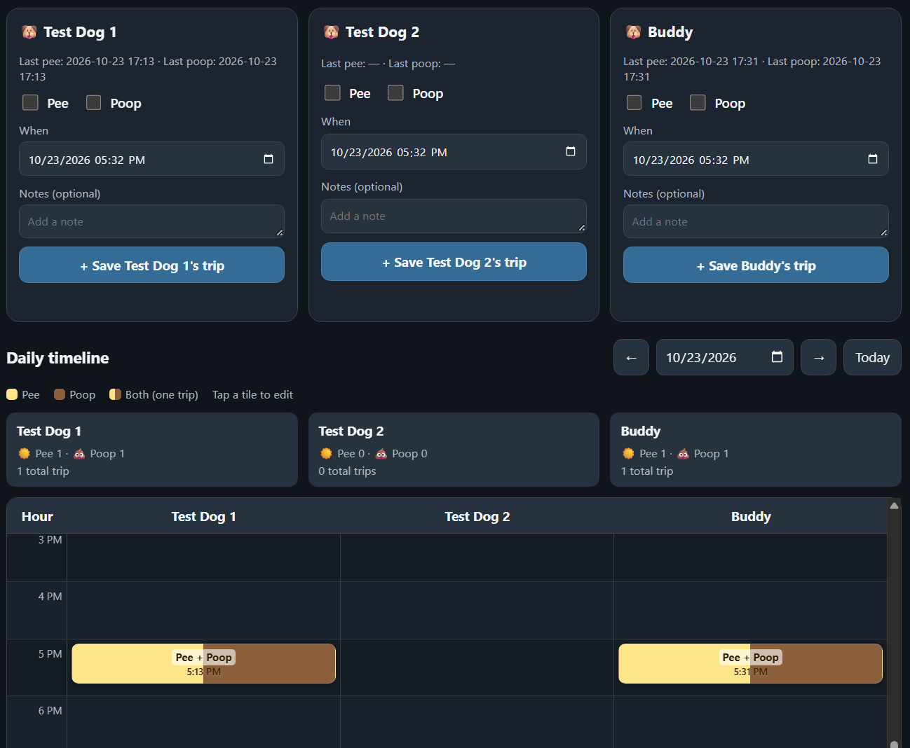
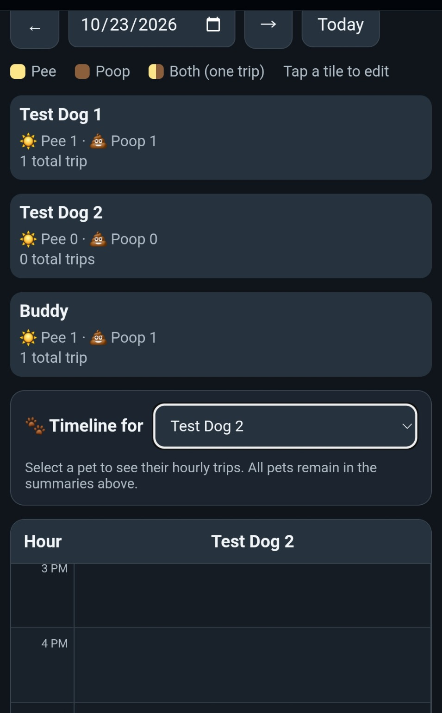
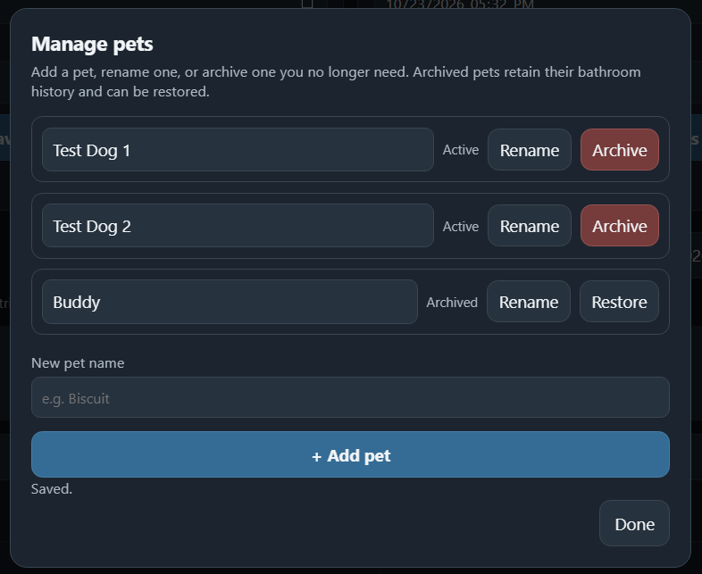

# Pet Bathroom Tracker — Home Assistant App



 

**Preview v0.5.5** — a free, local-first bathroom tracker for multiple pets, shared inside Home Assistant. Record pee, poop, or both; review a color-coded timeline; and edit history from your phone, tablet, or computer.

[](https://my.home-assistant.io/redirect/supervisor_add_addon_repository/?repository_url=https%3A%2F%2Fgithub.com%2FMonsoonSaloon%2Fpet-bathroom-tracker-home-assistant)

> **Experimental preview.** Tested on AMD64 Home Assistant OS: installation from this public repository, first-pet onboarding, shared access by non-admin Home Assistant users, trip persistence across app restarts, an in-place upgrade from v0.5.3 to v0.5.4 with records preserved, and backup recovery. A fresh reinstall also registered its Home Assistant update entity without restarting Core. Automated ARM64 container tests passed, but a full Home Assistant OS installation on ARM64 hardware has not been verified. No independent security audit has been completed.

## ❤️ Support the Project

If you find Pet Bathroom Tracker useful and want to support continued development, you can leave a one-time donation on Ko-fi.

[](https://ko-fi.com/monsoonsaloon)

Pet Bathroom Tracker is free and open source, and I intend to keep it that way. Donations are optional, start at $1, and help support this project and future open-source development.

## Features

- **Any number of pets:** custom names, emoji icons, and archiving without deleting history.
- **Fast entry:** pee, poop, or both; timestamp and optional notes.
- **Clear history:** daily totals and editable, color-coded hourly timeline.
- **Mobile friendly:** one-pet timeline selector on narrow displays; all pets on larger screens.
- **Shared household data:** authorized Home Assistant users see the same database through Ingress.
- **Local storage:** private SQLite database, with Home Assistant app backups (`backup: cold`).

## Screenshots

These are **real screenshots from earlier preview test builds**, cropped to show only the app. They use demonstration pet names; the same tracking and management features are available in v0.5.4.

### Desktop — multi-pet tracker and color-coded timeline



### Mobile — daily totals and one-pet timeline selector



### Manage pets — rename, archive and restore



## Install in five steps (Home Assistant OS)

**Requirements:** Home Assistant OS with Supervisor and access to **Settings → Apps**. AMD64 has been tested on a complete Home Assistant OS installation. ARM64 is included but has not yet been tested on a full Home Assistant OS installation.

1. Use the **Add repository** badge above, or open **Settings → Apps → Install app → ⋮ → Repositories** and add `https://github.com/MonsoonSaloon/pet-bathroom-tracker-home-assistant`.
2. Find **Pet Bathroom Tracker (Preview)** in the app store and choose **Install**.
3. Open **Configuration** and choose your time zone (e.g., `America/New_York`). Save the options.
4. Start the app and select **Open Web UI**. Click **Add your first pet** and choose a name/icon.
5. Enable **Show in sidebar** for convenient access by other Home Assistant users who have permission to use the app. Enable **Start on boot** for normal day-to-day use; **Watchdog** is optional.

No Proxmox, Samba, extra Linux server, or port forwarding is needed for users running Home Assistant OS. **This is not a HACS integration** and is not an official Home Assistant app.

### Updating safely

1. Create a manual Home Assistant backup containing this app. Save the encryption recovery key in a secure location.
2. On **Settings → Apps**, open its available update and review the changelog.
3. **Update in place**; do not uninstall, as that can remove persistent app data.
4. Verify saved pets and entries remain after the update. The update may require the app container to restart; it should not require restarting Home Assistant Core.

**Verified update test:** On an AMD64 Home Assistant OS test installation, updating v0.5.3 to v0.5.4 preserved the existing pet and its bathroom history.

Older **Local app** installations have a different Supervisor app identity: adding the public GitHub repository does **not** automatically transfer their data. Back up first and plan a separate migration.

## How it works

Each pet has an entry form and counts for the selected day. The timeline shows trips with distinct colors for pee, poop and combined events. Entries can be edited or deleted from history. With more pets, the timeline expands on desktop; on phones, choose which pet to display. Archived pets can be restored later, with their records retained.

Data is shared with everyone who can access the app via Home Assistant—there are no per-user permissions. The server doesn't publish a LAN port or require an external account. The database lives at `/data/tracker.db` in persistent app storage.

## Privacy and backup

All tracking data stays on your Home Assistant system unless you back it up to other destinations. Home Assistant Ingress authenticates users. The project does not include third-party telemetry. **Anyone with access to the app can change or delete its data.** Keep backups of the app and its SQLite database; Home Assistant app backup uses `backup: cold` to stop writes during the backup.

**Verified recovery (October 23, 2026):** A manual encrypted app backup was restored to a separate Home Assistant OS VM, recovering pet names, an emoji icon, and bathroom records. An edit persisted after restarting the restored app. Separately, a Proxmox VM snapshot rollback recovered the v0.5.4 test installation and its original bathroom entry. These are successful isolated tests, not a guarantee across all configurations.

## Compatibility and status

| Item | Status |
|---|---|
| Home Assistant OS / AMD64 | Tested (installation, use, in-place update, backup restore, fresh-install update-entity discovery) |
| Home Assistant OS / ARM64 | Automated container tests passed; **full Home Assistant OS installation not yet tested** |
| Home Assistant Container / Core | App store installation method not supported |
| GitHub-hosted installation | Tested |
| Built container image | Built on the HA machine; pre-built images not yet available |
| Current release channel | Experimental preview |

**Screenshots:** The gallery above uses cropped screenshots from earlier test versions with demonstration records. Branding artwork is in `assets/`. Future screenshots should also exclude private IP addresses, account identifiers, personal pet details, and access tokens.

## Troubleshooting

**Repository or app is missing from the store**

- Verify you are running **Home Assistant OS**, not a Core-only or Container-only installation.
- Confirm the repository URL was added under **Settings → Apps → Install app → ⋮ → Repositories**, then refresh the browser.
- If it still does not appear, check **Settings → System → Logs**, select the **Supervisor** log, and look for repository validation or installation errors. See [Home Assistant's repository troubleshooting guidance](https://www.home-assistant.io/common-tasks/os/).

**App installs but doesn't open**

- Open the app's **Info** tab and check whether it is **Running**.
- Review the app's **Log** tab for startup errors; verify your time zone under **Configuration**.
- If you need help, [open a bug report](https://github.com/MonsoonSaloon/pet-bathroom-tracker-home-assistant/issues/new/choose), omitting passwords, authentication tokens, backup archives, database files, and other sensitive details.

**Update status is missing or doesn't offer a button**

- Confirm that a newer version actually exists. If the installed and latest versions match, an **Update** button is not expected.
- The **Update** entity may be found under **Settings → Devices & services → Entities** by searching for **Pet Bathroom Tracker**; its status can show **Up-to-date**.
- Refresh the Home Assistant interface and recheck the app details before considering any Core restart. During v0.5.4 testing, the update entity appeared on a clean installation without a Core restart.
- For an issue that persists, use the [bug report form](https://github.com/MonsoonSaloon/pet-bathroom-tracker-home-assistant/issues/new/choose).

**Records disappear after uninstalling**

- Uninstalling can delete the app's private persistent data. Avoid uninstalling as an update method.
- Check for a Home Assistant backup that includes **Pet Bathroom Tracker (Preview)** and refer to the [backup and recovery guide](RECOVERY.md) before attempting restoration.

## Documentation and help

- [Home Assistant in-app documentation](pet_bathroom_tracker/DOCS.md)
- [Release history and upgrade notes](CHANGELOG.md)
- [Backup and recovery guide](RECOVERY.md)
- [Security and privacy](SECURITY.md)
- [Release verification checklist](RELEASE_CHECKLIST.md)
- [Publishing and maintenance](PUBLISHING.md)
- [Report a bug or request a feature](https://github.com/MonsoonSaloon/pet-bathroom-tracker-home-assistant/issues/new/choose)
- [Existing issues and bug reports](https://github.com/MonsoonSaloon/pet-bathroom-tracker-home-assistant/issues)

## Development and automated checks

```bash
python3 -m pip install pyyaml
python3 -m unittest discover -s tests -v
```

The [Source checks workflow](.github/workflows/checks.yml) runs database tests, Python syntax checks, shell syntax checks and a JavaScript syntax check for pushes and pull requests. The repository also runs automated AMD64 and ARM64 container architecture tests. These checks cannot substitute for a full Home Assistant OS installation test on each architecture.

## License

[MIT](LICENSE)
